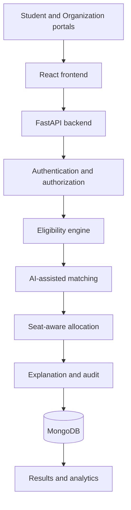

# Smart Internship Allocation Engine (SIH25033)

Independent college hackathon prototype for **AI-Based Smart Allocation Engine for PM Internship Scheme**.

> 🚀 **Unified Next.js 15 Fullstack Edition**: This project is now a single-framework Next.js 15 App Router project combining frontend and backend into one cohesive application.
> 
> **To run immediately**:
> ```powershell
> cd E:\smart-internship2
> npm install
> npm run dev
> ```
> Visit [http://localhost:3000](http://localhost:3000). See the complete [Next.js Developer Guide](docs/NEXTJS_GUIDE.md).

This repository is **not** an official Government of India product and is **not** integrated with the PM Internship Scheme.


## Problem

Many students compete for a limited number of internships with different eligibility rules, skills, locations, and ranked preferences. Manual shortlisting mixed those concerns into one opaque decision.

## Objectives

1. **Eligibility** — can this student apply?
2. **Matching** — how well does the internship fit? (compatibility, not probability)
3. **Allocation** — given seats and competing applicants, who receives the offer?

## Key features

- Student, organization, and administrator portals
- JWT authentication and role-based access
- Profile, resume PDF extraction (review before save), internship publishing
- Rule-based eligibility engine
- Weighted matching with keyword aliases and optional semantic layer
- Seat-aware deferred-acceptance allocation, waitlist, reallocation, what-if simulation
- Explanations and audit logs
- Live admin analytics from the database
- Deterministic demo seed (22 students, 8 internships)

## Technology stack

React, Vite, Tailwind CSS, React Router, Axios, Recharts, FastAPI, Pydantic, PyMongo, JWT, bcrypt, scikit-learn (optional TF-IDF), PyMuPDF, mongomock fallback.

## Architecture

See [docs/architecture.md](docs/architecture.md) and [docs/allocation_algorithm.md](docs/allocation_algorithm.md).



See the complete guide in [docs/RUN_GUIDE.md](docs/RUN_GUIDE.md) for full execution options, cloud deployment steps, and troubleshooting.

## Quick Installation (Windows)

Python 3.11+ / 3.12+ / 3.14 and Node.js 18+ / 20+ are required. MongoDB is optional for local demo (uses built-in in-memory mongomock by default).

```powershell
# In project root:
python -m venv backend\.venv
backend\.venv\Scripts\Activate.ps1
pip install -r backend\requirements.txt
copy backend\.env.example backend\.env

cd frontend
npm install
copy .env.example .env
cd ..
```

## Environment

Copy `backend/.env.example`. Important keys:

| Variable | Purpose |
| --- | --- |
| `SECRET_KEY` | JWT signing. Change before any public host. |
| `USE_MEMORY_DB` | `true` for mongomock demo without MongoDB |
| `MONGODB_URI` | Atlas or local MongoDB when `USE_MEMORY_DB=false` |
| `DEMO_ADMIN_EMAIL` / `DEMO_ADMIN_PASSWORD` | Seeded admin |
| `ENABLE_SEMANTIC_MATCHING` | Optional; stays off unless you install sentence-transformers and set true |
| `CORS_ORIGINS` | Frontend origins |

Frontend: `VITE_API_URL` (empty string uses the Vite `/api` proxy in development).

## Run locally

**Terminal 1 (Backend):**

```powershell
cd backend
.\.venv\Scripts\Activate.ps1
uvicorn app.main:app --reload --port 8000
```

Empty databases auto-seed automatically. To manually reset demo data:

```powershell
python ..\scripts\seed_database.py
```

**Terminal 2 (Frontend):**

```powershell
cd frontend
npm run dev
```

Open http://127.0.0.1:5173  
API docs: http://127.0.0.1:8000/docs  
Health: http://127.0.0.1:8000/api/health

## Demo logins (local development only)

| Role | Email | Password |
| --- | --- | --- |
| Administrator | `admin@example.com` | `Admin@12345` |
| Student (strong cyber profile) | `aarav@example.com` | `Student@12345` |
| Student (high CGPA, ML) | `diya@example.com` | `Student@12345` |
| Organization | `org-nic@example.com` | `Org@12345` |

Change these before any public deployment.

### Judge demonstration

1. Landing page — problem and three engines.
2. Sign in as `aarav@example.com` — profile, skills, preferences.
3. Discover internships — eligibility, match breakdown (not a probability).
4. Sign in as admin — dashboard counts from the database.
5. Allocation control — **Run Smart Allocation**, then **Publish**.
6. Results, explanations, waitlist.
7. Reject an offer to reallocate a waitlisted candidate.
8. What-if simulation — change seats; published records stay unchanged.

## Testing

```powershell
cd E:\smart-internship\backend
.\.venv\Scripts\Activate.ps1
pytest

cd E:\smart-internship\frontend
npm test
```

## Deployment

See [docs/deployment.md](docs/deployment.md). Cloud hosting is documented, not assumed.

## Known limitations

- In-memory mongomock does not persist across process restarts and is not suitable for production.
- Semantic matching is off by default; keyword matching is the verified path.
- Resume parsing needs selectable text in the PDF (no OCR).
- Organization accounts require administrator approval before publishing internships.
- Synchronous allocation is intended for hackathon-scale data.

## Future enhancements

OR-Tools solvers, OCR, email notifications, fairness dashboards, multilingual UI, official data-source integration if authorized.

## Team

First-year engineering SIH team. Keep engines in `backend/app/services` so eligibility, matching, and allocation stay testable without the UI.

## License

MIT — see `LICENSE`.
