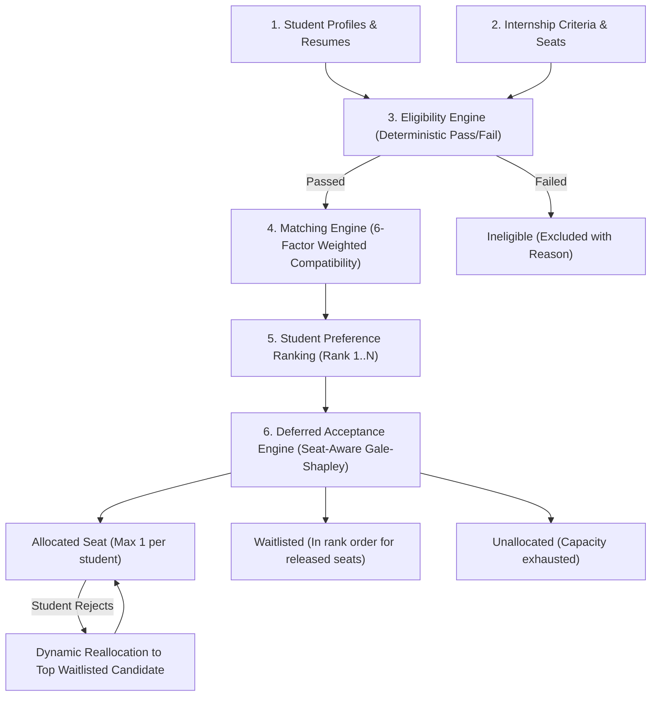

# Smart Internship Allocation Engine — Next.js Fullstack Developer Guide

> **SIH25033 Prototype**: Unified fullstack application running entirely on **Next.js 15 (App Router)**. Both the frontend (React 19, Tailwind CSS) and backend (Next.js API route handlers, in-memory DB & MongoDB support) coexist in a single, unified codebase.

---

## 1. Quick Start (Run in 1 Minute)

### Prerequisites
- **Node.js**: v18.0.0 or later (v20+ or v24+ recommended)
- **npm**: v9+ (comes with Node.js)
- *Optional*: MongoDB Atlas or local MongoDB (an in-memory database is built-in and enabled by default, requiring **zero** external database setup).

### Installation & Execution

```powershell
# 1. Navigate to the project root
cd E:\smart-internship2

# 2. Install dependencies (if not already installed)
npm install

# 3. Start the unified development server
npm run dev
```

Open your browser at **[http://localhost:3000](http://localhost:3000)**.

The application automatically seeds 22 students, 9 internships, 3 organizations, and pre-computed applications on first startup!

---

## 2. Demo Login Credentials

*(You can use either `@gmail.com` or `@example.com`)*

| Role | Email | Password | Access URL |
|---|---|---|---|
| **Administrator** | `admin@gmail.com` *(or `admin@example.com`)* | `Admin@12345` | `http://localhost:3000/admin` |
| **Student (Aarav)** | `aarav@gmail.com` *(or `aarav@example.com`)* | `Student@12345` | `http://localhost:3000/student` |
| **Student (Diya)** | `diya@gmail.com` *(or `diya@example.com`)* | `Student@12345` | `http://localhost:3000/student` |
| **Organization (NIC)** | `org-nic@gmail.com` *(or `org-nic@example.com`)* | `Org@12345` | `http://localhost:3000/org` |


---

## 3. Available npm Scripts

```powershell
npm run dev      # Start Next.js development server at http://localhost:3000
npm run build    # Build optimized production bundle (checks all 73 routes)
npm start        # Start Next.js production server
npm run seed     # Manually re-seed in-memory or MongoDB database
```

---

## 4. Environment Configuration (`.env.local`)

Next.js automatically reads environment variables from `.env.local` located at the project root:

```env
# Database Mode: 'true' uses built-in in-memory DB (zero setup). 'false' connects to MONGODB_URI.
USE_MEMORY_DB=true

# MongoDB connection (used when USE_MEMORY_DB=false)
MONGODB_URI=mongodb+srv://<username>:<password>@cluster0.mongodb.net
MONGODB_DB_NAME=smart_internship

# Authentication & Security
SECRET_KEY=dev-only-change-before-production-use
ACCESS_TOKEN_EXPIRE_MINUTES=480
ALGORITHM=HS256

# Demo Accounts
DEMO_ADMIN_EMAIL=admin@example.com
DEMO_ADMIN_PASSWORD=Admin@12345

# Resume Parsing
MAX_RESUME_MB=5
```

---

## 5. Architecture & Project Structure

The project has been converted from separate React + FastAPI applications into a single, cohesive Next.js 15 App Router architecture:

```
E:\smart-internship2/
├── app/                                 # Next.js App Router (Pages & API Routes)
│   ├── layout.jsx                       # Root layout (AuthProvider, theme)
│   ├── globals.css                      # Tailwind CSS 4 theme & styles
│   ├── page.jsx                         # Landing page
│   ├── about/page.jsx                   # About page
│   ├── how-it-works/page.jsx            # How algorithm works
│   ├── contact/page.jsx                 # Support & contact
│   ├── login/page.jsx                   # Sign in
│   ├── register/page.jsx                # Student registration
│   ├── register/organization/page.jsx   # Organization registration
│   │
│   ├── student/                         # Student Portal
│   │   ├── page.jsx                     # Dashboard (overview & progress)
│   │   ├── profile/page.jsx             # Profile management
│   │   ├── internships/page.jsx         # Discover & search internships
│   │   ├── internships/[id]/page.jsx    # Internship detail & direct apply
│   │   ├── applications/page.jsx        # Track applications & status
│   │   ├── preferences/page.jsx         # Preference ranking (Rank 1..N)
│   │   ├── resume/page.jsx              # PDF resume upload & parsing
│   │   ├── matches/page.jsx             # AI/weighted match analysis
│   │   ├── results/page.jsx             # Allocation results & offer rejection
│   │   ├── history/page.jsx             # Historical submissions
│   │   └── settings/page.jsx            # Account settings
│   │
│   ├── org/                             # Organization Portal
│   │   ├── page.jsx                     # Org Dashboard
│   │   ├── internships/page.jsx         # Manage postings
│   │   ├── internships/new/page.jsx     # Create new internship
│   │   ├── internships/[id]/page.jsx    # View applicants & close posting
│   │   ├── stats/page.jsx               # Application analytics chart
│   │   └── settings/page.jsx            # Company profile settings
│   │
│   ├── admin/                           # Administrator Portal
│   │   ├── page.jsx                     # Admin overview (totals & charts)
│   │   ├── students/page.jsx            # View all students
│   │   ├── organizations/page.jsx       # Approve / revoke organizations
│   │   ├── internships/page.jsx         # View all internships
│   │   ├── applications/page.jsx        # View all applications & eligibility
│   │   ├── eligibility/page.jsx         # Rule breakdown per candidate
│   │   ├── matching/page.jsx            # Compatibility score distribution
│   │   ├── allocation/page.jsx          # Execute Gale-Shapley round & publish
│   │   ├── results/page.jsx             # Allocation breakdown with explanations
│   │   ├── waitlist/page.jsx            # Dynamic waitlist & reallocation
│   │   ├── simulation/page.jsx          # What-if capacity simulation
│   │   ├── audit/page.jsx               # Immutable audit logs & CSV export
│   │   ├── config/page.jsx              # Matching weight configuration
│   │   └── settings/page.jsx            # System reset & demo reload
│   │
│   └── api/                             # Backend API Routes
│       ├── health/                      # System health check & DB status
│       ├── auth/                        # JWT login, register, me
│       ├── students/                    # Profile, resume parsing, applications
│       ├── internships/                 # CRUD for internship listings
│       ├── organizations/               # Org stats & internships
│       ├── applications/                # Apply, review, query
│       ├── eligibility/                 # Rule engine verification
│       ├── matching/                    # 6-factor compatibility calculation
│       ├── allocation/                  # Gale-Shapley engine, rounds, simulate
│       └── admin/                       # Dashboard stats, CSV export, weights
│
├── components/                          # Shared UI Components
│   ├── common/
│   │   ├── UI.jsx                       # Badge, Button, Card, Table, Modal, Field
│   │   └── ErrorBoundary.jsx            # React error boundary
│   └── layouts/
│       ├── DashboardLayout.jsx          # Role-based sidebar layout (Student/Org/Admin)
│       └── PublicLayout.jsx             # Header & footer layout for public pages
│
├── context/
│   └── AuthContext.jsx                  # Client-side React Auth state & session
│
├── lib/                                 # Core Backend Services & Business Logic
│   ├── config.js                        # Environment config reader
│   ├── db.js                            # MongoDB client + In-Memory DB engine
│   ├── auth.js                          # Password hash (bcrypt) & JWT (jsonwebtoken)
│   ├── audit.js                         # Audit trail logging
│   ├── seed.js                          # Database seeder (22 students, 9 internships)
│   ├── apiClient.js                     # Client-side API request handler
│   └── services/
│       ├── eligibility.js               # Multi-factor eligibility evaluator
│       ├── matching.js                  # 6-factor compatibility scorer
│       ├── allocation.js                # Deferred Acceptance (Gale-Shapley) algorithm
│       ├── allocationService.js         # Round manager, publication, reallocation
│       ├── explanation.js               # Plain-language explanation generator
│       ├── resumeParser.js              # PDF resume parser
│       └── systemConfig.js              # Dynamic weights & policy settings
│
├── scripts/
│   └── seed.mjs                         # Standalone CLI seeder
├── next.config.mjs                      # Next.js configuration
└── package.json                         # Unified package dependencies
```

---

## 6. How the Allocation Pipeline Works



### Factors in Matching Score (0–100)
1. **Skill Match (30%)**: Jaccard similarity between candidate skills and required/preferred internship skills with synonym expansion.
2. **Academic Fit (20%)**: CGPA performance scaled against requirements.
3. **Student Preference (20%)**: Applicant rank order ($Rank\ 1 = 100\%$, decreasing by $15\%$ per rank).
4. **Project Experience (10%)**: Relevance of project keywords to internship domain.
5. **Location & Work Mode (10%)**: Match between student preference (remote/hybrid/onsite) and posting.
6. **Certifications (10%)**: Valid domain certifications.

---

## 7. Complete Demo Walkthrough

### Step 1: Browse Public Portal & Login
1. Open `http://localhost:3000/`.
2. Notice the allocation pipeline diagram and problem statement.
3. Click **Login** and sign in as `aarav@example.com` (Password: `Student@12345`).

### Step 2: Student Experience
1. **Dashboard**: View profile completion and status.
2. **Discover Internships**: Filter internships by mode (`remote`, `hybrid`, `onsite`) and domain.
3. **Resume Parsing**: Go to **Resume**, upload a PDF to see automated skill extraction.
4. **Preferences**: Go to **Preferences**, rank your preferred internships ($1, 2, 3$).
5. **Match Analysis**: View your fit scores across all listings.

### Step 3: Organization Experience
1. Sign out and log in as `org-nic@example.com` (Password: `Org@12345`).
2. View total applications received across company listings.
3. Create a new internship posting with branch, CGPA, and seat capacity limits.
4. View applicants and their eligibility badges.

### Step 4: Administrator Experience (Allocation Execution)
1. Sign out and log in as `admin@example.com` (Password: `Admin@12345`).
2. **Admin Dashboard**: View total students, organizations, internships, and applications.
3. **Eligibility**: Inspect which candidates passed or failed specific criteria (e.g., minimum CGPA, branch match).
4. **Allocation Control**: Click **Run new round**. The Gale-Shapley Deferred Acceptance algorithm executes in memory.
5. Click **Publish** to release results to students.
6. **Results**: View allocated seats, waitlist order, and plain-language audit explanations for each candidate.
7. **Simulation**: Adjust seat capacities on the fly and see what-if differences without modifying published records.
8. **Waitlist & Reallocation**: Reject an offer to see the system dynamically assign the seat to the next valid waitlisted candidate.
9. **Audit Logs**: Export complete CSV logs for external verification.

---

## 8. Deployment (Vercel / Node.js Host)

Since the entire application is now a standard Next.js 15 project:

### Deploy to Vercel
1. Push repository to GitHub.
2. Import project into [Vercel](https://vercel.com).
3. Set environment variable: `USE_MEMORY_DB=true` (or provide `MONGODB_URI` for persistent Atlas storage).
4. Deploy!

### Deploy via Docker or VPS
```bash
npm run build
npm start
```
The server will run on port `3000` (or `PORT` environment variable).
