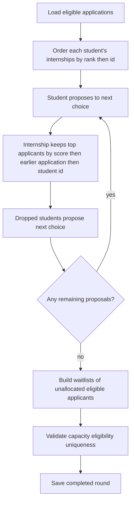

# Allocation algorithm

Prototype policy version: `v1.0-deferred-acceptance`.

This is a demonstration policy, not an official SIH requirement.

## Hard constraints

1. Ineligible applications are never allocated.
2. An internship never receives more allocated students than `seats`.
3. A student receives at most one internship per round (`max_allocations_per_student`, default 1).
4. Every allocated row references an application and a reason code.
5. If validation fails, the run is rejected and nothing is published.

## Matching versus allocation

Compatibility scores rank fit. They are **not** selection probabilities. A 95/100 score does not mean a 95% chance of a seat.

## Scoring formula

Default weights (must be non-negative and sum to 100):

- Skills 30
- Academic 20
- Preference 20
- Projects 10
- Location 10
- Certifications 10

```
overall = Σ (factor_score_0_to_100 × weight / 100)
```

### Skills

Normalized keyword overlap with alias expansion (`python programming` matches `Python`). Optional semantic cosine similarity is blended in only when `ENABLE_SEMANTIC_MATCHING=true` and a model or TF-IDF is available. The `method` field reports `keyword` or `keyword+tfidf` / `keyword+sentence-transformers`.

### Academic

CGPA below the internship minimum scores 0. Otherwise:

```
headroom = max(0.01, 10 - minimum_cgpa)
normalized = (cgpa - minimum_cgpa) / headroom
score = 55 + 45 × clamp(normalized, 0, 1)
```

Meeting the threshold does not automatically award 100. Extra CGPA above the floor still helps, but eligibility already enforced the floor.

### Preference

- Rank 1 → 100, rank 2 → 80, rank 3 → 60, decreasing by 20 down to a floor of 20.
- Domain-only match (internship unranked) → 70.
- Missing preferences → `missing_preference_score` (default 40). Missing is never treated as a perfect match.

### Location, projects, certifications

See `backend/app/services/matching.py`. Certifications are not mandatory unless listed in `mandatory_skills` on the internship (eligibility).

## Deferred acceptance (student-proposing)



### Tie-break

Default `tie_break=earlier_application`:

1. Higher match score first
2. Earlier `applied_at`
3. Lexicographic `student_id`

The result is deterministic for identical inputs and policy.

## Waitlist and reallocation

Waitlist size is `max(seats × waitlist_size_multiplier, 5)` per internship, excluding students already allocated elsewhere.

When an allocated offer is rejected, the engine marks it `rejected`, then offers the seat to the next waitlisted candidate for that internship who is still eligible and not already allocated. Other allocations are left unchanged and the event is audited.

## Simulation

`POST /api/allocation/rounds/{id}/simulate` re-runs allocation in memory with optional seat or weight overrides. It never writes allocation documents. The response includes a diff against published allocations.

## Round lifecycle

`processing` (in-request) → `validated` (if constraints pass) → `completed` (persisted) → `published` (visible to students). Publishing a new round marks a previous published round as `superseded`. Failed validation does not persist allocations.
