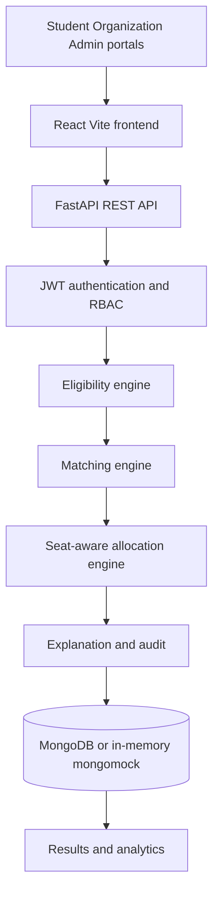

# Architecture — Smart Internship Allocation Engine

Independent SIH25033 prototype. Not an official PM Internship Scheme product.

## Layered design

## Module boundaries

| Layer | Location | Responsibility |
| --- | --- | --- |
| UI | `frontend/src` | Role-aware pages. Never computes eligibility, scores, or seats. |
| API | `backend/app/routes` | Validation, auth, persistence. |
| Eligibility | `backend/app/services/eligibility.py` | Deterministic pass/fail rules. |
| Matching | `backend/app/services/matching.py` | Weighted compatibility. Keyword first; optional semantic. |
| Allocation | `backend/app/services/allocation.py` | Deferred acceptance with capacity and waitlist. |
| Explanation | `backend/app/services/explanation.py` | Human-readable narratives without competitor PII. |
| Data | MongoDB collections | Users, profiles, internships, applications, rounds, allocations, audit. |

## Trust model

Browsers may display scores returned by the API. They cannot submit a match score or allocation status that the server will trust. Allocation runs only through administrator endpoints.

## Database fallback

If `USE_MEMORY_DB=true` or a local MongoDB ping fails in development, the backend uses `mongomock`. Production (`APP_ENV=production`) requires a reachable `MONGODB_URI`.
